# Thiết kế Sơ đồ Quan hệ Thực thể (ERD) - MadK Store

Tài liệu này định nghĩa chi tiết mô hình cơ sở dữ liệu quan hệ cho hệ thống **MadK Store** (PostgreSQL 16), bao gồm các phân hệ chính từ Giai đoạn 1 đến Giai đoạn 4 theo [PLAN.md](file:///c:/Users/ADMIN/Downloads/MadK-Store/PLAN.md).

---

## 1. Tổng quan kiến trúc dữ liệu

Hệ thống sử dụng cơ sở dữ liệu quan hệ **PostgreSQL 16** với các đặc thù:
- **Khóa chính (PK):** `UUID` (`gen_random_uuid()`) cho tất cả các bảng nghiệp vụ chính nhằm tránh rò rỉ số lượng bản ghi qua URL (chống IDOR enumeration) và hỗ trợ distributed systems.
- **Thông số kỹ thuật linh hoạt:** Kiểu dữ liệu `JSONB` kết hợp **GIN index** cho phép lọc thuộc tính linh hoạt theo từng danh mục mà không cần thay đổi schema.
- **Tìm kiếm toàn văn:** Cột `tsvector` kết hợp **GIN index** phục vụ tìm kiếm Full-Text Search tiếng Việt không dấu/có dấu tốc độ cao.
- **Kiểm soát tính toàn vẹn và snapshot:** Các giao dịch mua hàng (`orders`, `order_items`) bắt buộc lưu snapshot thông tin sản phẩm, giá, địa chỉ và thông số tại thời điểm đặt hàng.
- **Quản lý kho hai tầng:** Tồn thực (`quantity_on_hand`) và tồn đang giữ (`quantity_reserved`) kết hợp đặt chỗ có thời hạn (`stock_reservations`) đảm bảo an toàn truy cập đồng thời.

---

## 2. Sơ đồ Mermaid ERD tổng thể

```mermaid
erDiagram
    %% ==========================================
    %% 1. PHÂN HỆ CATALOG
    %% ==========================================
    categories ||--o{ categories : "cha-con (parent_id)"
    categories ||--o{ products : "chứa"
    categories ||--o| category_spec_templates : "định nghĩa schema"
    brands ||--o{ products : "sản xuất"
    products ||--o{ product_variants : "có biến thể"
    products ||--o{ product_images : "có ảnh"
    product_variants ||--o{ product_images : "gắn ảnh biến thể"
    product_variants ||--o{ price_histories : "ghi nhận lịch sử giá"
    promotions ||--o{ promotion_variants : "áp dụng"
    product_variants ||--o{ promotion_variants : "tham gia"

    %% ==========================================
    %% 2. PHÂN HỆ NGƯỜI DÙNG & PHÂN QUYỀN
    %% ==========================================
    users ||--o{ user_roles : "gán role"
    roles ||--o{ user_roles : "thuộc về"
    roles ||--o{ role_permissions : "chứa quyền"
    permissions ||--o{ role_permissions : "được cấp cho"
    users ||--o{ addresses : "sở hữu"

    %% ==========================================
    %% 3. PHÂN HỆ MUA HÀNG & ĐƠN HÀNG
    %% ==========================================
    users ||--o{ carts : "sở hữu"
    carts ||--o{ cart_items : "chứa"
    product_variants ||--o{ cart_items : "được thêm vào"
    users ||--o{ orders : "đặt hàng"
    coupons ||--o{ orders : "áp dụng mã"
    orders ||--o{ order_items : "chi tiết dòng hàng"
    product_variants ||--o{ order_items : "tham chiếu gốc"
    orders ||--o{ payments : "thanh toán"
    orders ||--o{ return_requests : "khiếu nại hoàn trả"
    return_requests ||--o{ return_request_items : "gồm các món"
    order_items ||--o{ return_request_items : "được yêu cầu hoàn"

    %% ==========================================
    %% 4. PHÂN HỆ QUẢN LÝ KHO & NHẬP HÀNG
    %% ==========================================
    product_variants ||--|| inventories : "quản lý tồn"
    orders ||--o{ stock_reservations : "giữ hàng cho"
    product_variants ||--o{ stock_reservations : "được giữ"
    product_variants ||--o{ stock_movements : "biến động kho"
    suppliers ||--o{ purchase_orders : "cung cấp"
    users ||--o{ purchase_orders : "nhân viên tạo"
    purchase_orders ||--o{ purchase_order_items : "chi tiết phiếu nhập"
    product_variants ||--o{ purchase_order_items : "được nhập"

    %% ==========================================
    %% 5. PHÂN HỆ HỆ THỐNG
    %% ==========================================
    users ||--o{ audit_logs : "thực hiện hành động"
```

---

## 3. Chi tiết các nhóm bảng và lược đồ

### 3.1. Phân hệ Catalog & Sản phẩm

#### Bảng `categories` (Danh mục phân cấp dạng cây)
- Lưu cấu trúc cây danh mục nhiều cấp (Laptop > Laptop Gaming, Phụ kiện > Sạc, Tai nghe...).

| Cột | Kiểu dữ liệu | Ràng buộc | Diễn giải |
|---|---|---|---|
| `id` | `UUID` | **PK** | Định danh danh mục |
| `parent_id` | `UUID` | **FK** -> `categories(id)`, Nullable | Danh mục cha (NULL nếu là danh mục gốc) |
| `name` | `VARCHAR(150)` | NOT NULL | Tên hiển thị danh mục |
| `slug` | `VARCHAR(180)` | NOT NULL, **UNIQUE** | Đường dẫn thân thiện SEO (e.g. `laptop-gaming`) |
| `description` | `TEXT` | Nullable | Mô tả danh mục |
| `icon_url` | `VARCHAR(500)` | Nullable | Biểu tượng danh mục |
| `display_order` | `INT` | NOT NULL, DEFAULT 0 | Thứ tự sắp xếp trên menu |
| `is_active` | `BOOLEAN` | NOT NULL, DEFAULT true | Trạng thái bật/tắt hiển thị |
| `created_at` | `TIMESTAMPTZ` | NOT NULL, DEFAULT now() | Ngày tạo |
| `updated_at` | `TIMESTAMPTZ` | Nullable | Ngày cập nhật |

- **Indexes:**
  - `idx_categories_slug` (B-Tree trên `slug`, Unique)
  - `idx_categories_parent_id` (B-Tree trên `parent_id`)
  - `idx_categories_is_active_order` (B-Tree composite `(is_active, display_order)`)

---

#### Bảng `brands` (Thương hiệu)

| Cột | Kiểu dữ liệu | Ràng buộc | Diễn giải |
|---|---|---|---|
| `id` | `UUID` | **PK** | Định danh thương hiệu |
| `name` | `VARCHAR(100)` | NOT NULL | Tên hãng (Apple, ASUS, Sony...) |
| `slug` | `VARCHAR(120)` | NOT NULL, **UNIQUE** | Slug SEO (e.g. `apple`, `asus`) |
| `logo_url` | `VARCHAR(500)` | Nullable | Đường dẫn logo thương hiệu |
| `description` | `TEXT` | Nullable | Giới thiệu thương hiệu |
| `is_active` | `BOOLEAN` | NOT NULL, DEFAULT true | Trạng thái hiển thị |
| `created_at` | `TIMESTAMPTZ` | NOT NULL, DEFAULT now() | Ngày tạo |
| `updated_at` | `TIMESTAMPTZ` | Nullable | Ngày cập nhật |

- **Indexes:**
  - `idx_brands_slug` (B-Tree trên `slug`, Unique)

---

#### Bảng `category_spec_templates` (Định nghĩa Schema thông số kỹ thuật)
- Chứa schema JSONSchema định dạng các trường cấu hình của category (ví dụ Laptop phải có: CPU, RAM, GPU, Màn hình; Tai nghe có: Kiểu kết nối, Pin, Chống ồn).
- Phục vụ việc render form nhập liệu động cho admin và sinh bộ lọc tự động ở storefront.

| Cột | Kiểu dữ liệu | Ràng buộc | Diễn giải |
|---|---|---|---|
| `id` | `UUID` | **PK** | Định danh mẫu schema |
| `category_id` | `UUID` | **FK** -> `categories(id)`, **UNIQUE** | Một category gắn tối đa 1 schema thông số |
| `schema_definition` | `JSONB` | NOT NULL | JSON Schema cấu trúc các trường, kiểu dữ liệu, danh sách lựa chọn cho bộ lọc |
| `created_at` | `TIMESTAMPTZ` | NOT NULL, DEFAULT now() | Ngày tạo |
| `updated_at` | `TIMESTAMPTZ` | Nullable | Ngày cập nhật |

- **Indexes:**
  - `idx_category_spec_templates_category_id` (B-Tree trên `category_id`, Unique)
  - `idx_category_spec_templates_schema_gin` (**GIN index** trên `schema_definition`)

---

#### Bảng `products` (Thông tin chung của sản phẩm)

| Cột | Kiểu dữ liệu | Ràng buộc | Diễn giải |
|---|---|---|---|
| `id` | `UUID` | **PK** | Định danh sản phẩm |
| `category_id` | `UUID` | **FK** -> `categories(id)` | Thuộc danh mục nào |
| `brand_id` | `UUID` | **FK** -> `brands(id)` | Thuộc thương hiệu nào |
| `name` | `VARCHAR(250)` | NOT NULL | Tên sản phẩm |
| `slug` | `VARCHAR(280)` | NOT NULL, **UNIQUE** | Slug SEO thân thiện |
| `short_description` | `VARCHAR(500)` | Nullable | Mô tả ngắn tóm tắt |
| `description` | `TEXT` | Nullable | Nội dung chi tiết (HTML hoặc Markdown) |
| `specifications` | `JSONB` | NOT NULL, DEFAULT '{}' | **Thông số kỹ thuật sản phẩm theo schema của Category** |
| `model_3d_url` | `VARCHAR(500)` | Nullable | **Đường dẫn file 3D (.glb/.gltf)** (chỉ 5-10 sản phẩm nổi bật, rỗng nếu không có 3D) |
| `thumbnail_url` | `VARCHAR(500)` | Nullable | Ảnh đại diện chính 2D |
| `base_price` | `NUMERIC(15,2)`| NOT NULL | Giá gốc hiển thị tham khảo từ |
| `is_featured` | `BOOLEAN` | NOT NULL, DEFAULT false | Đánh dấu hiển thị trang chủ/hero |
| `is_active` | `BOOLEAN` | NOT NULL, DEFAULT true | Ẩn/hiện sản phẩm |
| `search_vector` | `TSVECTOR` | Nullable | Vector phục vụ Full-Text Search tiếng Việt |
| `created_at` | `TIMESTAMPTZ` | NOT NULL, DEFAULT now() | Ngày tạo |
| `updated_at` | `TIMESTAMPTZ` | Nullable | Ngày cập nhật |

- **Indexes:**
  - `idx_products_slug` (B-Tree trên `slug`, Unique)
  - `idx_products_category_id` (B-Tree trên `category_id`)
  - `idx_products_brand_id` (B-Tree trên `brand_id`)
  - `idx_products_base_price` (B-Tree trên `base_price`)
  - `idx_products_specifications_gin` (**GIN index** trên `specifications` phục vụ lọc thuộc tính động CPU, RAM, etc.)
  - `idx_products_search_vector_gin` (**GIN index** trên `search_vector` cho Full-Text Search)

---

#### Bảng `product_variants` (SKU - Biến thể chi tiết)
- Giữ thông tin phân loại: màu sắc, dung lượng, phiên bản, giá bán thực tế và SKU quản lý kho.

| Cột | Kiểu dữ liệu | Ràng buộc | Diễn giải |
|---|---|---|---|
| `id` | `UUID` | **PK** | Định danh biến thể |
| `product_id` | `UUID` | **FK** -> `products(id)` | Thuộc sản phẩm nào |
| `sku` | `VARCHAR(100)` | NOT NULL, **UNIQUE** | Mã đơn vị lưu kho duy nhất (SKU) |
| `name` | `VARCHAR(200)` | NOT NULL | Tên biến thể (e.g. "Xám Không Gian - 512GB") |
| `attributes` | `JSONB` | NOT NULL | Thuộc tính biến thể, e.g. `{"color": "Space Gray", "storage": "512GB", "color_hex": "#505155"}` (phục vụ map vật liệu 3D) |
| `original_price` | `NUMERIC(15,2)`| NOT NULL | Giá bán niêm yết |
| `sale_price` | `NUMERIC(15,2)`| NOT NULL | Giá bán thực tế hiện tại |
| `cost_price` | `NUMERIC(15,2)`| NOT NULL, DEFAULT 0 | Giá vốn nhập hàng tham khảo |
| `is_active` | `BOOLEAN` | NOT NULL, DEFAULT true | Trạng thái kinh doanh |
| `created_at` | `TIMESTAMPTZ` | NOT NULL, DEFAULT now() | Ngày tạo |
| `updated_at` | `TIMESTAMPTZ` | Nullable | Ngày cập nhật |

- **Indexes:**
  - `idx_product_variants_sku` (B-Tree trên `sku`, Unique)
  - `idx_product_variants_product_id` (B-Tree trên `product_id`)
  - `idx_product_variants_sale_price` (B-Tree trên `sale_price`)
  - `idx_product_variants_attributes_gin` (**GIN index** trên `attributes`)

---

#### Bảng `product_images` (Bộ sưu tập ảnh sản phẩm)

| Cột | Kiểu dữ liệu | Ràng buộc | Diễn giải |
|---|---|---|---|
| `id` | `UUID` | **PK** | Định danh ảnh |
| `product_id` | `UUID` | **FK** -> `products(id)` | Thuộc sản phẩm |
| `variant_id` | `UUID` | **FK** -> `product_variants(id)`, Nullable | Gắn với biến thể cụ thể (nếu có) |
| `image_url` | `VARCHAR(500)` | NOT NULL | Đường dẫn ảnh CDN/MinIO |
| `alt_text` | `VARCHAR(200)` | Nullable | Thuộc tính alt cho SEO |
| `display_order` | `INT` | NOT NULL, DEFAULT 0 | Thứ tự hiển thị |
| `is_primary` | `BOOLEAN` | NOT NULL, DEFAULT false | Là ảnh đại diện chính của sản phẩm/biến thể |
| `created_at` | `TIMESTAMPTZ` | NOT NULL, DEFAULT now() | Ngày tạo |

- **Indexes:**
  - `idx_product_images_product_id` (B-Tree trên `product_id`)
  - `idx_product_images_variant_id` (B-Tree trên `variant_id`)

---

#### Bảng `price_histories` (Lịch sử thay đổi giá)
- Đảm bảo ghi nhận lịch sử điều chỉnh giá phục vụ kiểm toán và phân tích biên độ lợi nhuận.

| Cột | Kiểu dữ liệu | Ràng buộc | Diễn giải |
|---|---|---|---|
| `id` | `UUID` | **PK** | Định danh bản ghi lịch sử |
| `variant_id` | `UUID` | **FK** -> `product_variants(id)` | Thuộc biến thể nào |
| `old_original_price`| `NUMERIC(15,2)`| NOT NULL | Giá gốc cũ |
| `new_original_price`| `NUMERIC(15,2)`| NOT NULL | Giá gốc mới |
| `old_sale_price` | `NUMERIC(15,2)`| NOT NULL | Giá khuyến mãi/bán cũ |
| `new_sale_price` | `NUMERIC(15,2)`| NOT NULL | Giá khuyến mãi/bán mới |
| `effective_from` | `TIMESTAMPTZ` | NOT NULL | Thời điểm bắt đầu hiệu lực |
| `effective_to` | `TIMESTAMPTZ` | Nullable | Thời điểm hết hiệu lực (NULL là hiện hành) |
| `changed_by_user_id`| `UUID` | **FK** -> `users(id)` | Người điều chỉnh giá |
| `reason` | `VARCHAR(250)` | Nullable | Lý do điều chỉnh |
| `created_at` | `TIMESTAMPTZ` | NOT NULL, DEFAULT now() | Ngày tạo |

- **Indexes:**
  - `idx_price_histories_variant_effective` (B-Tree composite `(variant_id, effective_from)`)

---

#### Bảng `promotions` và `promotion_variants` (Chương trình khuyến mãi có thời hạn)

| Bảng | Cột | Kiểu | Ràng buộc | Ghi chú |
|---|---|---|---|---|
| `promotions` | `id` | `UUID` | **PK** | Định danh chương trình |
| | `name` | `VARCHAR(200)` | NOT NULL | Tên chương trình (VD: "Back to School 2026") |
| | `description` | `TEXT` | Nullable | Thể lệ chương trình |
| | `discount_type`| `VARCHAR(20)` | NOT NULL | `Percentage` hoặc `FixedAmount` |
| | `discount_value`| `NUMERIC(15,2)`| NOT NULL | Phần trăm (e.g. 15.00) hoặc số tiền cố định |
| | `start_date` | `TIMESTAMPTZ` | NOT NULL | Bắt đầu lúc |
| | `end_date` | `TIMESTAMPTZ` | NOT NULL | Kết thúc lúc |
| | `is_active` | `BOOLEAN` | NOT NULL, DEFAULT true | Trạng thái bật/tắt |
| | `created_at` | `TIMESTAMPTZ` | NOT NULL, DEFAULT now() | Ngày tạo |
| | `updated_at` | `TIMESTAMPTZ` | Nullable | Ngày cập nhật |
| `promotion_variants`| `promotion_id` | `UUID` | **PK, FK** -> `promotions(id)` | Khóa chính phức hợp |
| | `variant_id` | `UUID` | **PK, FK** -> `product_variants(id)` | Áp dụng cho SKU nào |

---

### 3.2. Phân hệ Người dùng & Phân quyền (Identity & Access Control)

Theo quyết định thiết kế: **chỉ dùng một bảng User duy nhất kèm Role/Permission**. Customer kế thừa quyền của Guest. Mọi quyền kiểm tra ở server, không lưu session RAM.

#### Bảng `users`

| Cột | Kiểu dữ liệu | Ràng buộc | Diễn giải |
|---|---|---|---|
| `id` | `UUID` | **PK** | Định danh người dùng |
| `email` | `VARCHAR(255)` | NOT NULL, **UNIQUE** | Email đăng nhập |
| `password_hash` | `VARCHAR(255)` | NOT NULL | Mật khẩu băm bằng **BCrypt** |
| `full_name` | `VARCHAR(150)` | NOT NULL | Họ và tên |
| `phone_number` | `VARCHAR(20)` | Nullable | Số điện thoại liên lạc |
| `avatar_url` | `VARCHAR(500)` | Nullable | Ảnh đại diện |
| `is_active` | `BOOLEAN` | NOT NULL, DEFAULT true | Khóa/mở khóa tài khoản |
| `email_confirmed` | `BOOLEAN` | NOT NULL, DEFAULT false | Đã xác thực email chưa |
| `refresh_token` | `VARCHAR(255)` | Nullable | Token làm mới phiên JWT |
| `refresh_token_expires_at`| `TIMESTAMPTZ` | Nullable | Thời hạn refresh token |
| `created_at` | `TIMESTAMPTZ` | NOT NULL, DEFAULT now() | Ngày tạo |
| `updated_at` | `TIMESTAMPTZ` | Nullable | Ngày cập nhật |

- **Indexes:**
  - `idx_users_email` (B-Tree trên `email`, Unique)
  - `idx_users_phone` (B-Tree trên `phone_number`)

---

#### Bảng `roles`, `permissions`, `user_roles`, `role_permissions`
- Hỗ trợ Role-Based Access Control (RBAC) & Fine-grained Permission đúng ma trận quyền trong PLAN.md (Customer, Sales, Warehouse, Admin).

| Bảng | Cột | Kiểu dữ liệu | Ràng buộc | Diễn giải |
|---|---|---|---|---|
| `roles` | `id` | `UUID` | **PK** | Định danh vai trò |
| | `name` | `VARCHAR(50)` | NOT NULL, **UNIQUE** | Tên vai trò (`Admin`, `Sales`, `Warehouse`, `Customer`) |
| | `description`| `VARCHAR(250)`| Nullable | Mô tả trách nhiệm |
| `permissions` | `id` | `UUID` | **PK** | Định danh quyền hạn |
| | `code` | `VARCHAR(100)`| NOT NULL, **UNIQUE** | Mã quyền kỹ thuật (e.g. `order.view_all`, `inventory.adjust`, `product.create`) |
| | `module` | `VARCHAR(50)` | NOT NULL | Phân hệ (`Catalog`, `Order`, `Inventory`, `User`, `Report`) |
| | `description`| `VARCHAR(250)`| Nullable | Diễn giải quyền |
| `user_roles` | `user_id` | `UUID` | **PK, FK** -> `users(id)` | Liên kết N-N User - Role |
| | `role_id` | `UUID` | **PK, FK** -> `roles(id)` | |
| `role_permissions`| `role_id` | `UUID` | **PK, FK** -> `roles(id)` | Liên kết N-N Role - Permission |
| | `permission_id`| `UUID` | **PK, FK** -> `permissions(id)` | |

---

#### Bảng `addresses` (Sổ địa chỉ người dùng chuẩn Việt Nam)

| Cột | Kiểu dữ liệu | Ràng buộc | Diễn giải |
|---|---|---|---|
| `id` | `UUID` | **PK** | Định danh địa chỉ |
| `user_id` | `UUID` | **FK** -> `users(id)` | Thuộc người dùng nào |
| `recipient_name` | `VARCHAR(150)` | NOT NULL | Tên người nhận hàng |
| `phone_number` | `VARCHAR(20)` | NOT NULL | Số điện thoại người nhận |
| `province_code` | `VARCHAR(20)` | NOT NULL | Mã Tỉnh/Thành phố (theo chuẩn danh mục VN) |
| `province_name` | `VARCHAR(100)` | NOT NULL | Tên Tỉnh/Thành phố |
| `district_code` | `VARCHAR(20)` | NOT NULL | Mã Quận/Huyện |
| `district_name` | `VARCHAR(100)` | NOT NULL | Tên Quận/Huyện |
| `ward_code` | `VARCHAR(20)` | NOT NULL | Mã Phường/Xã |
| `ward_name` | `VARCHAR(100)` | NOT NULL | Tên Phường/Xã |
| `detailed_address` | `VARCHAR(255)` | NOT NULL | Địa chỉ chi tiết (số nhà, tên đường, tòa nhà) |
| `is_default` | `BOOLEAN` | NOT NULL, DEFAULT false | Đánh dấu địa chỉ giao hàng mặc định |
| `created_at` | `TIMESTAMPTZ` | NOT NULL, DEFAULT now() | Ngày tạo |
| `updated_at` | `TIMESTAMPTZ` | Nullable | Ngày cập nhật |

- **Indexes:**
  - `idx_addresses_user_id` (B-Tree trên `user_id`)

---

### 3.3. Phân hệ Mua hàng & Đơn hàng (Shopping & Orders)

#### Bảng `carts` và `cart_items` (Giỏ hàng)
- Phục vụ lưu giỏ hàng DB cho user đã đăng nhập hoặc khách vãng lai thông qua `anonymous_id`/session token.

| Bảng | Cột | Kiểu | Ràng buộc | Ghi chú |
|---|---|---|---|---|
| `carts` | `id` | `UUID` | **PK** | Định danh giỏ hàng |
| | `user_id` | `UUID` | **FK** -> `users(id)`, Nullable | NULL đối với khách chưa đăng nhập |
| | `anonymous_id` | `VARCHAR(100)` | Nullable, **UNIQUE** | Cookie identifier cho khách vãng lai |
| | `created_at` | `TIMESTAMPTZ` | NOT NULL, DEFAULT now() | Ngày tạo |
| | `updated_at` | `TIMESTAMPTZ` | Nullable | Cập nhật lần cuối |
| `cart_items` | `id` | `UUID` | **PK** | Định danh món hàng trong giỏ |
| | `cart_id` | `UUID` | **FK** -> `carts(id)` | Giỏ hàng cha |
| | `variant_id` | `UUID` | **FK** -> `product_variants(id)`| Biến thể chọn mua |
| | `quantity` | `INT` | NOT NULL, CHECK (quantity > 0) | Số lượng mua |
| | `created_at` | `TIMESTAMPTZ` | NOT NULL, DEFAULT now() | Ngày thêm vào giỏ |
| | `updated_at` | `TIMESTAMPTZ` | Nullable | Ngày cập nhật số lượng |

- **Ràng buộc:** `UNIQUE (cart_id, variant_id)` để một biến thể chỉ xuất hiện 1 dòng trong cùng 1 giỏ.

---

#### Bảng `coupons` (Mã giảm giá)

| Cột | Kiểu dữ liệu | Ràng buộc | Diễn giải |
|---|---|---|---|
| `id` | `UUID` | **PK** | Định danh mã |
| `code` | `VARCHAR(50)` | NOT NULL, **UNIQUE** | Ký tự mã giảm giá (e.g. `MADKNEW2026`) |
| `description` | `VARCHAR(255)` | Nullable | Mô tả mã |
| `discount_type` | `VARCHAR(20)` | NOT NULL | `Percentage` (Phần trăm) hoặc `FixedAmount` (Tiền mặt) |
| `discount_value` | `NUMERIC(15,2)`| NOT NULL | Giá trị giảm |
| `min_order_value` | `NUMERIC(15,2)`| NOT NULL, DEFAULT 0 | Giá trị đơn tối thiểu để áp dụng |
| `max_discount_amount`| `NUMERIC(15,2)`| Nullable | Mức giảm tối đa (khi dùng kiểu %) |
| `usage_limit` | `INT` | Nullable | Tổng số lượt dùng tối đa toàn hệ thống |
| `used_count` | `INT` | NOT NULL, DEFAULT 0 | Đã dùng bao nhiêu lượt |
| `start_date` | `TIMESTAMPTZ` | NOT NULL | Bắt đầu hiệu lực |
| `end_date` | `TIMESTAMPTZ` | NOT NULL | Hết hạn |
| `is_active` | `BOOLEAN` | NOT NULL, DEFAULT true | Trạng thái kích hoạt |
| `created_at` | `TIMESTAMPTZ` | NOT NULL, DEFAULT now() | Ngày tạo |
| `updated_at` | `TIMESTAMPTZ` | Nullable | Ngày cập nhật |

---

#### Bảng `orders` (Đơn hàng)
- **Quy tắc bắt buộc:** Server luôn tính lại giá khi tạo đơn. Lưu snapshot địa chỉ giao hàng và thông tin mã giảm giá.

| Cột | Kiểu dữ liệu | Ràng buộc | Diễn giải |
|---|---|---|---|
| `id` | `UUID` | **PK** | Định danh đơn hàng |
| `order_number` | `VARCHAR(50)` | NOT NULL, **UNIQUE** | Mã đơn hiển thị cho khách (e.g. `ORD-20261010-9821`) |
| `user_id` | `UUID` | **FK** -> `users(id)` | Khách hàng đặt mua (kiểm tra chống IDOR) |
| `coupon_id` | `UUID` | **FK** -> `coupons(id)`, Nullable | Mã giảm giá đã áp dụng |
| `status` | `VARCHAR(30)` | NOT NULL | Trạng thái: `Pending`, `Confirmed`, `Shipping`, `Completed`, `Cancelled`, `Returned` |
| `payment_status` | `VARCHAR(30)` | NOT NULL | Trạng thái thanh toán: `Unpaid`, `Paid`, `PartiallyRefunded`, `Refunded` |
| `payment_method` | `VARCHAR(30)` | NOT NULL | Hình thức: `COD`, `VNPay` |
| `subtotal_amount` | `NUMERIC(15,2)`| NOT NULL | Tổng tiền hàng trước giảm giá (tính lại từ server) |
| `discount_amount` | `NUMERIC(15,2)`| NOT NULL, DEFAULT 0 | Số tiền được giảm giá |
| `shipping_fee` | `NUMERIC(15,2)`| NOT NULL, DEFAULT 0 | Phí vận chuyển |
| `total_amount` | `NUMERIC(15,2)`| NOT NULL | **Tổng số tiền phải thanh toán** (`subtotal - discount + shipping`) |
| `shipping_address_snapshot`| `JSONB` | NOT NULL | **[SNAPSHOT]** Lưu trọn vẹn: Tên người nhận, SĐT, Tỉnh, Huyện, Xã, Địa chỉ chi tiết lúc mua |
| `coupon_snapshot` | `JSONB` | Nullable | **[SNAPSHOT]** Lưu: Mã code, loại giảm giá, giá trị giảm lúc áp dụng |
| `customer_note` | `TEXT` | Nullable | Ghi chú của khách hàng |
| `admin_note` | `TEXT` | Nullable | Ghi chú nội bộ của nhân viên sales/kho |
| `cancel_reason` | `VARCHAR(255)` | Nullable | Lý do hủy đơn nếu bị hủy |
| `cancelled_at` | `TIMESTAMPTZ` | Nullable | Thời điểm hủy |
| `created_at` | `TIMESTAMPTZ` | NOT NULL, DEFAULT now() | Ngày tạo đơn |
| `updated_at` | `TIMESTAMPTZ` | Nullable | Ngày cập nhật trạng thái |

- **Indexes:**
  - `idx_orders_order_number` (B-Tree trên `order_number`, Unique)
  - `idx_orders_user_id` (B-Tree trên `user_id` - tăng tốc query "Đơn hàng của tôi")
  - `idx_orders_status_payment` (B-Tree composite `(status, payment_status)`)
  - `idx_orders_created_at` (B-Tree trên `created_at`)

---

#### Bảng `order_items` (Chi tiết dòng sản phẩm trong đơn)
- **Quy tắc bắt buộc:** **Lưu SNAPSHOT hoàn toàn** tên sản phẩm, tên biến thể, SKU, giá, thuộc tính màu/cấu hình và thông số kỹ thuật cốt lõi để đơn hàng cũ không bao giờ bị ảnh hưởng khi sản phẩm đổi tên/giá/xóa.

| Cột | Kiểu dữ liệu | Ràng buộc | Diễn giải |
|---|---|---|---|
| `id` | `UUID` | **PK** | Định danh dòng hàng |
| `order_id` | `UUID` | **FK** -> `orders(id)` | Thuộc đơn hàng nào |
| `variant_id` | `UUID` | **FK** -> `product_variants(id)`, Nullable | Khóa ngoại tham chiếu (để null nếu biến thể sau này bị xóa cứng) |
| `product_name_snapshot` | `VARCHAR(250)` | NOT NULL | **[SNAPSHOT]** Tên sản phẩm tại thời điểm mua |
| `variant_name_snapshot` | `VARCHAR(200)` | NOT NULL | **[SNAPSHOT]** Tên biến thể tại thời điểm mua |
| `sku_snapshot` | `VARCHAR(100)` | NOT NULL | **[SNAPSHOT]** Mã SKU tại thời điểm mua |
| `unit_price_snapshot` | `NUMERIC(15,2)`| NOT NULL | **[SNAPSHOT]** Đơn giá bán thực tế tại thời điểm mua (server tính) |
| `original_price_snapshot`| `NUMERIC(15,2)`| NOT NULL | **[SNAPSHOT]** Giá niêm yết tại thời điểm mua |
| `quantity` | `INT` | NOT NULL, CHECK (quantity > 0) | Số lượng mua |
| `total_price` | `NUMERIC(15,2)`| NOT NULL | Thành tiền (`unit_price_snapshot * quantity`) |
| `attributes_snapshot` | `JSONB` | NOT NULL | **[SNAPSHOT]** Thuộc tính cấu hình: màu sắc, dung lượng, v.v. |
| `specifications_snapshot`| `JSONB` | Nullable | **[SNAPSHOT]** Tóm tắt thông số kỹ thuật cốt lõi |
| `created_at` | `TIMESTAMPTZ` | NOT NULL, DEFAULT now() | Ngày tạo |

- **Indexes:**
  - `idx_order_items_order_id` (B-Tree trên `order_id`)
  - `idx_order_items_variant_id` (B-Tree trên `variant_id`)

---

#### Bảng `payments` (Giao dịch thanh toán)
- Đảm bảo xử lý Webhook/IPN **idempotent**, lưu vết toàn bộ giao dịch trực tuyến (VNPay) và COD.

| Cột | Kiểu dữ liệu | Ràng buộc | Diễn giải |
|---|---|---|---|
| `id` | `UUID` | **PK** | Định danh bản ghi giao dịch |
| `order_id` | `UUID` | **FK** -> `orders(id)` | Thuộc đơn hàng nào |
| `payment_method` | `VARCHAR(30)` | NOT NULL | `VNPay`, `COD` |
| `transaction_reference` | `VARCHAR(100)` | Nullable | Mã giao dịch ngân hàng/VNPay trả về (`vnp_TransactionNo`) |
| `idempotency_key` | `VARCHAR(150)` | NOT NULL, **UNIQUE** | Khóa chống trùng lặp xử lý IPN/Webhook nhiều lần |
| `amount` | `NUMERIC(15,2)`| NOT NULL | Số tiền thanh toán |
| `status` | `VARCHAR(30)` | NOT NULL | `Pending`, `Success`, `Failed`, `Refunded` |
| `raw_webhook_payload` | `JSONB` | Nullable | Payload gốc IPN từ cổng thanh toán để đối soát |
| `error_code` | `VARCHAR(50)` | Nullable | Mã lỗi (nếu có) từ cổng thanh toán |
| `paid_at` | `TIMESTAMPTZ` | Nullable | Thời điểm thanh toán thành công |
| `created_at` | `TIMESTAMPTZ` | NOT NULL, DEFAULT now() | Ngày khởi tạo giao dịch |
| `updated_at` | `TIMESTAMPTZ` | Nullable | Ngày cập nhật |

- **Indexes:**
  - `idx_payments_idempotency_key` (B-Tree trên `idempotency_key`, Unique)
  - `idx_payments_order_id` (B-Tree trên `order_id`)
  - `idx_payments_transaction_ref` (B-Tree trên `transaction_reference`)

---

#### Bảng `return_requests` và `return_request_items` (Quy trình Đổi trả / Hoàn tiền)

| Bảng | Cột | Kiểu | Ràng buộc | Ghi chú |
|---|---|---|---|---|
| `return_requests` | `id` | `UUID` | **PK** | Định danh yêu cầu đổi trả |
| | `order_id` | `UUID` | **FK** -> `orders(id)` | Yêu cầu thuộc đơn nào |
| | `user_id` | `UUID` | **FK** -> `users(id)` | Người gửi yêu cầu |
| | `status` | `VARCHAR(30)` | NOT NULL | `Requested`, `Approved`, `Rejected`, `Completed` |
| | `reason` | `TEXT` | NOT NULL | Lý do đổi trả |
| | `refund_amount` | `NUMERIC(15,2)`| NOT NULL, DEFAULT 0 | Số tiền hoàn trả (nếu hoàn tiền) |
| | `bank_info_snapshot` | `JSONB` | Nullable | **[SNAPSHOT]** Thông tin số tài khoản nhận tiền hoàn |
| | `processed_by_user_id`| `UUID` | **FK** -> `users(id)`, Nullable | Nhân viên Sales/Admin xử lý |
| | `processed_at` | `TIMESTAMPTZ` | Nullable | Thời điểm xử lý |
| | `admin_note` | `TEXT` | Nullable | Ghi chú phản hồi của nhân viên |
| | `created_at` | `TIMESTAMPTZ` | NOT NULL, DEFAULT now() | Ngày tạo |
| | `updated_at` | `TIMESTAMPTZ` | Nullable | Ngày cập nhật |
| `return_request_items` | `id` | `UUID` | **PK** | Định danh dòng đổi trả |
| | `return_request_id` | `UUID` | **FK** -> `return_requests(id)` | Thuộc phiếu yêu cầu nào |
| | `order_item_id` | `UUID` | **FK** -> `order_items(id)` | Thuộc dòng sản phẩm nào trong đơn |
| | `quantity` | `INT` | NOT NULL, CHECK (quantity > 0) | Số lượng yêu cầu trả |
| | `condition_note`| `VARCHAR(255)`| Nullable | Tình trạng hàng hóa (còn nguyên seal, lỗi mở nguồn...) |

---

### 3.4. Phân hệ Quản lý Kho & Nhập hàng (Inventory & Logistics)

Theo quyết định thiết kế: **Tồn kho có 2 mức: tồn thực (`quantity_on_hand`) và tồn đang giữ (`quantity_reserved`)**. Cơ chế trừ kho đồng thời an toàn bằng transaction và điều kiện nguyên tử:
`UPDATE inventories SET quantity_reserved = quantity_reserved + @qty WHERE quantity_on_hand - quantity_reserved >= @qty`.

#### Bảng `inventories` (Quản lý tồn kho hiện thời theo biến thể)

| Cột | Kiểu dữ liệu | Ràng buộc | Diễn giải |
|---|---|---|---|
| `id` | `UUID` | **PK** | Định danh kho |
| `variant_id` | `UUID` | **FK** -> `product_variants(id)`, **UNIQUE** | 1 biến thể có 1 bản ghi tồn kho |
| `quantity_on_hand` | `INT` | NOT NULL, DEFAULT 0, CHECK (quantity_on_hand >= 0) | **Tồn thực tế** trong kho |
| `quantity_reserved`| `INT` | NOT NULL, DEFAULT 0, CHECK (quantity_reserved >= 0) | **Tồn đang giữ** (đang chờ thanh toán/chờ đóng gói) |
| `reorder_threshold`| `INT` | NOT NULL, DEFAULT 5 | Ngưỡng báo động sắp hết hàng |
| `row_version` | `INT` | NOT NULL, DEFAULT 1 | Version phục vụ Optimistic Concurrency Control |
| `created_at` | `TIMESTAMPTZ` | NOT NULL, DEFAULT now() | Ngày tạo |
| `updated_at` | `TIMESTAMPTZ` | Nullable | Ngày cập nhật |

- **Ràng buộc toàn vẹn quan trọng:**
  - `CHECK (quantity_on_hand >= quantity_reserved)`: Tồn đang giữ không bao giờ được vượt quá tồn thực tế.
- **Tồn có thể bán (Available to Promise):** `quantity_on_hand - quantity_reserved`.

---

#### Bảng `stock_reservations` (Phiếu giữ tồn kho tạm thời)
- Phục vụ việc giữ hàng trong thời gian chờ khách thanh toán online (VNPay) hoặc chờ duyệt đơn COD.
- Khi quá hạn (`expires_at`), job nền (`Hangfire/RabbitMQ`) sẽ tự động hủy và giải phóng `quantity_reserved`.

| Cột | Kiểu dữ liệu | Ràng buộc | Diễn giải |
|---|---|---|---|
| `id` | `UUID` | **PK** | Định danh phiếu giữ hàng |
| `order_id` | `UUID` | **FK** -> `orders(id)` | Gắn với đơn hàng |
| `variant_id` | `UUID` | **FK** -> `product_variants(id)` | Biến thể được giữ hàng |
| `reserved_quantity`| `INT` | NOT NULL, CHECK (reserved_quantity > 0) | Số lượng giữ |
| `expires_at` | `TIMESTAMPTZ` | NOT NULL | Thời điểm hết hạn giữ (ví dụ: sau 15 phút nếu thanh toán VNPay) |
| `status` | `VARCHAR(30)` | NOT NULL | `Pending` (Đang giữ), `Committed` (Đã trừ kho thật), `Released` (Đã hoàn lại kho do hết hạn/hủy) |
| `created_at` | `TIMESTAMPTZ` | NOT NULL, DEFAULT now() | Ngày tạo |
| `updated_at` | `TIMESTAMPTZ` | Nullable | Ngày cập nhật |

- **Indexes:**
  - `idx_stock_reservations_status_expires` (B-Tree composite `(status, expires_at)` giúp job nền quét đơn quá hạn siêu nhanh)
  - `idx_stock_reservations_order_id` (B-Tree trên `order_id`)

---

#### Bảng `stock_movements` (Nhật ký lịch sử biến động kho - Ledger)
- Ghi nhận mọi giao dịch nhập, xuất, giữ, hoàn hàng. Không bao giờ xóa hay sửa bản ghi trong bảng này (Append-only).

| Cột | Kiểu dữ liệu | Ràng buộc | Diễn giải |
|---|---|---|---|
| `id` | `UUID` | **PK** | Định danh dòng biến động |
| `variant_id` | `UUID` | **FK** -> `product_variants(id)` | Biến thể |
| `movement_type` | `VARCHAR(40)` | NOT NULL | `InboundPurchase` (Nhập NCC), `OutboundOrder` (Xuất bán đơn), `ReturnRestock` (Khách trả hoàn kho), `AuditAdjustment` (Kiểm kê điều chỉnh), `DamageDisposal` (Xuất hủy hàng hỏng) |
| `quantity` | `INT` | NOT NULL | Số lượng biến động (số dương khi tăng kho, số âm khi giảm kho) |
| `quantity_before` | `INT` | NOT NULL | Tồn thực trước khi biến động |
| `quantity_after` | `INT` | NOT NULL | Tồn thực sau biến động |
| `reference_type` | `VARCHAR(40)` | NOT NULL | Loại chứng từ tham chiếu: `Order`, `PurchaseOrder`, `ReturnRequest`, `StockAudit` |
| `reference_id` | `VARCHAR(100)` | NOT NULL | Mã định danh chứng từ tham chiếu (order_id, po_number...) |
| `note` | `TEXT` | Nullable | Ghi chú chi tiết |
| `created_by_user_id`| `UUID` | **FK** -> `users(id)` | Nhân viên kho/Hệ thống thực hiện |
| `created_at` | `TIMESTAMPTZ` | NOT NULL, DEFAULT now() | Ngày ghi nhận |

- **Indexes:**
  - `idx_stock_movements_variant_created` (B-Tree composite `(variant_id, created_at)`)
  - `idx_stock_movements_reference` (B-Tree composite `(reference_type, reference_id)`)

---

#### Bảng `suppliers`, `purchase_orders`, `purchase_order_items` (Nhà cung cấp & Phiếu nhập hàng)

| Bảng | Cột | Kiểu | Ràng buộc | Ghi chú |
|---|---|---|---|---|
| `suppliers` | `id` | `UUID` | **PK** | Định danh nhà cung cấp |
| | `name` | `VARCHAR(200)` | NOT NULL | Tên nhà cung cấp (FPT Synnex, DGW...) |
| | `code` | `VARCHAR(50)` | NOT NULL, **UNIQUE** | Mã NCC (e.g. `SUP-DGW`) |
| | `contact_name`| `VARCHAR(100)` | Nullable | Người liên hệ |
| | `phone` | `VARCHAR(20)` | Nullable | Số điện thoại |
| | `email` | `VARCHAR(150)` | Nullable | Email liên hệ |
| | `address` | `VARCHAR(255)` | Nullable | Địa chỉ trụ sở |
| | `is_active` | `BOOLEAN` | NOT NULL, DEFAULT true | Trạng thái hoạt động |
| | `created_at` | `TIMESTAMPTZ` | NOT NULL, DEFAULT now() | Ngày tạo |
| `purchase_orders`| `id` | `UUID` | **PK** | Định danh phiếu nhập |
| | `po_number` | `VARCHAR(50)` | NOT NULL, **UNIQUE** | Mã phiếu nhập (e.g. `PO-202610-001`) |
| | `supplier_id` | `UUID` | **FK** -> `suppliers(id)` | Nhà cung cấp |
| | `status` | `VARCHAR(30)` | NOT NULL | `Draft`, `Ordered`, `PartialReceived`, `Completed`, `Cancelled` |
| | `total_amount` | `NUMERIC(15,2)`| NOT NULL, DEFAULT 0 | Tổng giá trị phiếu nhập |
| | `created_by_user_id`| `UUID`| **FK** -> `users(id)` | Nhân viên kho tạo phiếu |
| | `approved_by_user_id`| `UUID`| **FK** -> `users(id)`, Nullable | Quản lý/Admin phê duyệt |
| | `note` | `TEXT` | Nullable | Ghi chú nhập hàng |
| | `created_at` | `TIMESTAMPTZ` | NOT NULL, DEFAULT now() | Ngày tạo |
| | `updated_at` | `TIMESTAMPTZ` | Nullable | Ngày cập nhật |
| `purchase_order_items`| `id`| `UUID` | **PK** | Dòng sản phẩm nhập |
| | `purchase_order_id`| `UUID` | **FK** -> `purchase_orders(id)`| Thuộc phiếu nhập |
| | `variant_id` | `UUID` | **FK** -> `product_variants(id)`| Biến thể nhập |
| | `quantity_ordered` | `INT` | NOT NULL, CHECK (quantity_ordered > 0) | Số lượng đặt |
| | `quantity_received`| `INT` | NOT NULL, DEFAULT 0 | Số lượng thực tế đã nhập kho |
| | `unit_cost` | `NUMERIC(15,2)`| NOT NULL | Đơn giá vốn nhập |
| | `total_cost` | `NUMERIC(15,2)`| NOT NULL | Tổng tiền dòng |

---

### 3.5. Phân hệ Hệ thống & Kiểm toán (System & Audit)

#### Bảng `audit_logs` (Nhật ký kiểm toán thao tác quản trị)
- Ghi lại các thao tác nhạy cảm của Admin/Sales/Warehouse: ai đã sửa gì, vào lúc nào, giá trị cũ/mới ra sao.

| Cột | Kiểu dữ liệu | Ràng buộc | Diễn giải |
|---|---|---|---|
| `id` | `UUID` | **PK** | Định danh dòng log |
| `user_id` | `UUID` | **FK** -> `users(id)`, Nullable | Người thao tác (NULL nếu hệ thống tự chạy qua scheduler) |
| `user_email` | `VARCHAR(255)` | Nullable | Email người thao tác (lưu kèm phòng khi user bị xóa) |
| `action` | `VARCHAR(50)` | NOT NULL | Hành động: `CREATE`, `UPDATE`, `DELETE`, `STATUS_CHANGE`, `INVENTORY_ADJUST` |
| `entity_name` | `VARCHAR(100)` | NOT NULL | Tên bảng/thực thể chịu tác động (ví dụ: `Product`, `Order`, `Inventory`) |
| `entity_id` | `VARCHAR(100)` | NOT NULL | Khóa chính của thực thể chịu tác động |
| `old_values` | `JSONB` | Nullable | Snapshot dữ liệu trước khi thay đổi |
| `new_values` | `JSONB` | Nullable | Snapshot dữ liệu sau khi thay đổi |
| `ip_address` | `VARCHAR(45)` | Nullable | Địa chỉ IP người gọi |
| `user_agent` | `VARCHAR(500)` | Nullable | Trình duyệt / thiết bị gọi API |
| `created_at` | `TIMESTAMPTZ` | NOT NULL, DEFAULT now() | Thời điểm ghi nhận |

- **Indexes:**
  - `idx_audit_logs_entity` (B-Tree composite `(entity_name, entity_id)`)
  - `idx_audit_logs_user_id` (B-Tree trên `user_id`)
  - `idx_audit_logs_created_at` (B-Tree trên `created_at`)

---

## 4. Tóm tắt các trường lưu Snapshot bắt buộc

Để đảm bảo toàn vẹn dữ liệu kế toán và thương mại, các cột sau bắt buộc lưu **Snapshot cố định không phụ thuộc dữ liệu gốc**:

1. **`orders.shipping_address_snapshot` (`JSONB`):** Snapshot toàn bộ họ tên, SĐT, tỉnh/quận/xã, địa chỉ chi tiết lúc người dùng hoàn tất đặt hàng. Nếu sau này người dùng sửa sổ địa chỉ trong tài khoản, đơn hàng cũ vẫn giữ nguyên địa chỉ giao ban đầu.
2. **`orders.coupon_snapshot` (`JSONB`):** Snapshot mã giảm giá, kiểu giảm giá, mức giảm đã áp dụng.
3. **`order_items.product_name_snapshot` (`VARCHAR`):** Tên sản phẩm tại thời điểm mua.
4. **`order_items.variant_name_snapshot` (`VARCHAR`):** Tên phiên bản cấu hình tại thời điểm mua.
5. **`order_items.sku_snapshot` (`VARCHAR`):** Mã SKU tại thời điểm mua.
6. **`order_items.unit_price_snapshot` (`NUMERIC`):** Đơn giá bán thực tế do server tính toán lại.
7. **`order_items.original_price_snapshot` (`NUMERIC`):** Đơn giá gốc niêm yết tại thời điểm mua.
8. **`order_items.attributes_snapshot` (`JSONB`):** Màu sắc, RAM, ổ cứng của biến thể được mua.
9. **`order_items.specifications_snapshot` (`JSONB`):** Thông số kỹ thuật của sản phẩm lúc mua (phòng trường hợp admin cập nhật thông số sai lệch sau này).
10. **`return_requests.bank_info_snapshot` (`JSONB`):** Snapshot thông tin tài khoản ngân hàng khách cung cấp để hoàn tiền.

---

## 5. Tóm tắt các Index tối ưu hiệu năng quan trọng

1. **Index GIN cho JSONB:**
   - `idx_products_specifications_gin` trên `products.specifications`: Lọc nhanh các thông số kỹ thuật (RAM, CPU, Pin...).
   - `idx_product_variants_attributes_gin` trên `product_variants.attributes`: Lọc biến thể (Màu, Size, Bộ nhớ).
2. **Index GIN cho Full-Text Search tiếng Việt:**
   - `idx_products_search_vector_gin` trên `products.search_vector`: Phục vụ tìm kiếm từ khóa cực nhanh bằng PostgreSQL full-text search.
3. **Index B-Tree phục vụ kiểm tra truy cập đồng thời & Scheduler:**
   - `idx_stock_reservations_status_expires` trên `stock_reservations (status, expires_at)`: Tối ưu quét các đơn hết hạn thanh toán online để job nền giải phóng hàng.
   - `idx_payments_idempotency_key` trên `payments.idempotency_key` (Unique): Ngăn chặn việc webhook/IPN từ cổng thanh toán gọi lại nhiều lần gây cộng/trừ tiền trùng lặp.
   - `idx_orders_user_id` trên `orders.user_id`: Tối ưu hóa truy vấn danh sách đơn hàng của khách hàng và kiểm tra quyền sở hữu đơn (chống IDOR).

---

## 6. Các câu hỏi còn mở (Open Questions) cần người dùng xác nhận

Sau khi hoàn thiện thiết kế ERD sơ bộ, dưới đây là các câu hỏi thiết kế cần bạn chốt trước khi bước sang giai đoạn lập trình:

1. **Quy tắc hết hạn giỏ hàng cho khách vãng lai (Guest Cart):**
   - Giỏ hàng của khách vãng lai lưu trong DB (`carts.anonymous_id`) nên được lưu giữ trong bao lâu trước khi job nền tự động dọn dẹp (ví dụ: 7 ngày hay 30 ngày)? Hay ta ưu tiên lưu giỏ hàng của Guest hoàn toàn ở `localStorage` phía Frontend và chỉ đồng bộ lên DB khi khách đăng nhập?
2. **Cơ chế giữ hàng (`StockReservation`) cho phương thức COD:**
   - Với đơn COD, ta có giữ hàng ngay khi vừa bấm "Đặt hàng" (trạng thái `Pending`) hay chỉ giữ/trừ kho khi nhân viên Sales gọi điện "Xác nhận đơn" (`Confirmed`)?
   - *(Khuyến nghị: Với COD, giữ kho ngay khi đặt hàng để tránh bán vượt quá số lượng, nhưng cho phép Sales hủy đơn giải phóng kho nếu không liên lạc được với khách).*
3. **Cơ chế tính giá vốn tồn kho (`cost_price`):**
   - Giá vốn trong biến thể hiện tại đang lưu mức giá tham khảo (`product_variants.cost_price`). Khi tính báo cáo lợi nhuận gộp ở Giai đoạn 3, bạn muốn áp dụng phương pháp **Bình quân gia quyền (Weighted Average)** tính từ các phiếu nhập (`purchase_orders`), hay đơn giản là dùng giá vốn gần nhất?
4. **Xóa mềm (Soft Delete) vs Xóa cứng (Hard Delete):**
   - Sản phẩm, danh mục và biến thể hiện tại sử dụng cờ `is_active: false` (ẩn khỏi storefront). Bạn có muốn thêm cột `is_deleted` và `deleted_at` riêng cho tất cả thực thể để hỗ trợ khôi phục dữ liệu hay chỉ dùng cờ `is_active` là đủ?
