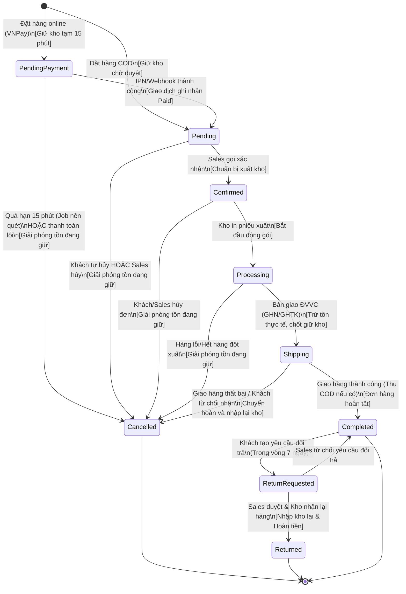

# Sơ đồ và Quy tắc Trạng thái Đơn hàng - MadK Store

Tài liệu này định nghĩa chi tiết **vòng đời trạng thái đơn hàng**, **tác động lên tồn kho**, **cơ chế xử lý quá hạn thanh toán** và **quy trình hủy / hoàn tiền** của hệ thống MadK Store.

---

## 1. Sơ đồ trạng thái đơn hàng (Mermaid State Diagram)



---

## 2. Bảng ma trận điều kiện chuyển trạng thái

| Trạng thái ban đầu | Trạng thái tiếp theo | Tác nhân kích hoạt | Điều kiện nghiệp vụ |
|---|---|---|---|
| `*` (Khởi tạo) | `PendingPayment` | Customer | Chọn phương thức thanh toán VNPay khi checkout. Hệ thống sinh URL thanh toán. |
| `*` (Khởi tạo) | `Pending` | Customer | Chọn phương thức COD khi checkout. |
| `PendingPayment` | `Pending` | Hệ thống (VNPay IPN) | Cổng thanh toán gửi IPN hợp lệ (chữ ký đúng, số tiền khớp, `vnp_ResponseCode == "00"`). |
| `PendingPayment` | `Cancelled` | Scheduler (Job nền) | Đơn quá hạn 15 phút chưa thanh toán thành công hoặc cổng báo giao dịch thất bại. |
| `Pending` | `Confirmed` | Sales / Admin | Nhân viên liên hệ xác minh thông tin nhận hàng và khách xác nhận mua. |
| `Pending` | `Cancelled` | Customer / Sales | Khách tự hủy trên web (chỉ được hủy ở trạng thái này) hoặc Sales hủy do không liên lạc được. |
| `Confirmed` | `Processing` | Warehouse | Nhân viên kho nhận lệnh và bắt đầu in phiếu nhặt hàng, đóng hộp. |
| `Processing` | `Shipping` | Warehouse | Kiện hàng được bàn giao cho đơn vị vận chuyển (GHN/GHTK) kèm mã vận đơn. |
| `Shipping` | `Completed` | Hệ thống (Webhook ĐVVC) / Sales | Khách đã nhận hàng thành công và thanh toán đủ tiền COD (nếu là COD). |
| `Shipping` | `Cancelled` | Hệ thống (Webhook ĐVVC) / Sales | Giao hàng thất bại sau 3 lần giao hoặc khách bùng hàng; hàng được chuyển hoàn về shop. |
| `Completed` | `ReturnRequested`| Customer | Khách gửi form yêu cầu đổi trả trong vòng 7 ngày kể từ lúc hoàn tất đơn. |
| `ReturnRequested` | `Returned` | Sales & Warehouse | Sales duyệt lý do đổi trả; Kho kiểm tra nhận lại hàng đúng tình trạng cam kết. |
| `ReturnRequested` | `Completed` | Sales | Sales từ chối yêu cầu đổi trả do vi phạm chính sách hoặc quá hạn. |

---

## 3. Tác động lên tồn kho chi tiết theo từng bước

Hệ thống quản lý tồn kho theo mô hình **2 tầng an toàn truy cập đồng thời**:
- `quantity_on_hand` (Tồn thực tế trong kho)
- `quantity_reserved` (Tồn đang giữ cho các đơn chưa xuất kho)
- Tồn khả dụng bán = `quantity_on_hand - quantity_reserved`

```
┌────────────────────────────────────────────────────────────────────────┐
│                              TỒN KHO THỰC TẾ                           │
│  ┌──────────────────────────────┬───────────────────────────────────┐  │
│  │   Tồn đang giữ (Reserved)    │     Tồn khả dụng bán (Available)   │  │
│  │  (Đơn Pending/Confirmed)     │        (Khách mới được mua)       │  │
│  └──────────────────────────────┴───────────────────────────────────┘  │
└────────────────────────────────────────────────────────────────────────┘
```

### Bảng chi tiết tác động tồn kho qua từng trạng thái:

| Bước trạng thái | Tác động `quantity_reserved` | Tác động `quantity_on_hand` | Thao tác `stock_reservations` | Ghi nhận `stock_movements` (Sổ cái) |
|---|---|---|---|---|
| **1. Khách đặt hàng** (`PendingPayment` hoặc `Pending` COD) | **TĂNG (+Qty)** | **KHÔNG ĐỔI** | Tạo bản ghi mới trạng thái `Pending` kèm `expires_at = now() + 15m` (online) | Không (chưa xuất kho thật) |
| **2. Thanh toán thành công** (`PendingPayment` -> `Pending`) | **KHÔNG ĐỔI** | **KHÔNG ĐỔI** | Cập nhật `expires_at = NULL` (không bị job nền hủy tự động) | Không |
| **3. Thanh toán quá hạn / Hủy đơn sớm** (`-> Cancelled`) | **GIẢM (-Qty)** | **KHÔNG ĐỔI** | Đổi trạng thái sang `Released` | Không |
| **4. Bàn giao giao hàng** (`Processing` -> `Shipping`) | **GIẢM (-Qty)** | **GIẢM (-Qty)** | Đổi trạng thái sang `Committed` | **GHI BẢN GHI:** `OutboundOrder` (âm Qty) |
| **5. Giao thất bại / Chuyển hoàn** (`Shipping` -> `Cancelled`) | **KHÔNG ĐỔI** | **TĂNG (+Qty)** | Đã commit trước đó | **GHI BẢN GHI:** `ReturnRestock` (dương Qty) |
| **6. Đổi trả nhập lại kho** (`ReturnRequested` -> `Returned`) | **KHÔNG ĐỔI** | **TĂNG (+Qty)** | Đã commit trước đó | **GHI BẢN GHI:** `ReturnRestock` (dương Qty) |

---

## 4. Xử lý thanh toán quá hạn (Timeout Scheduler)

Để ngăn chặn việc khách hàng treo đơn giữ hàng khiến người khác không mua được:

1. **Thời hạn giữ hàng:**
   - Khi tạo đơn online (VNPay), hệ thống tạo bản ghi `stock_reservations` với `expires_at = DateTime.UtcNow.AddMinutes(15)`.
2. **Job nền định kỳ (Hangfire / Background Worker):**
   - Chạy định kỳ mỗi **1 phút**.
   - Câu lệnh truy vấn tối ưu nhờ index `idx_stock_reservations_status_expires`:
     ```sql
     SELECT * FROM stock_reservations 
     WHERE status = 'Pending' AND expires_at <= NOW();
     ```
3. **Thao tác tự động khi quá hạn:**
   - Mở database transaction:
     - Chuyển trạng thái đơn hàng tương ứng sang `Cancelled` với lý do: `"Tự động hủy do quá thời hạn thanh toán 15 phút"`.
     - Chuyển `stock_reservations.status = 'Released'`.
     - Giảm `inventories.quantity_reserved = quantity_reserved - @reservedQty`.
   - Gửi thông báo/email cho khách hàng về việc đơn đã bị hủy.

---

## 5. Quy trình hủy đơn và hoàn tiền (Refund Flow)

### 5.1. Trường hợp đơn COD chưa giao
- Khách tự hủy hoặc Sales hủy.
- Hệ thống chỉ cần giải phóng tồn kho đang giữ (`quantity_reserved`). Không phát sinh giao dịch tiền tệ.

### 5.2. Trường hợp đơn đã thanh toán online (VNPay) bị hủy hoặc đổi trả
1. **Kiểm tra tính hợp lệ & Idempotent:**
   - Kiểm tra đơn hàng có `payment_status == 'Paid'` và đã ghi nhận bản ghi giao dịch thành công trong bảng `payments`.
   - Sinh mã `idempotency_key = "REFUND_" + order.Id + "_" + DateTime.UtcNow.Ticks`.
2. **Kích hoạt hoàn tiền:**
   - **Giai đoạn sandbox / MVP:** Hệ thống chuyển `payment_status = 'Refunded'`, ghi nhận bản ghi giao dịch âm trong `payments` và cập nhật thông tin hoàn tiền vào `return_requests`.
   - **Giai đoạn production:** Gọi API Refund của VNPay (`vnp_Command = "refund"`), truyền mã giao dịch gốc `vnp_TransactionNo`, số tiền hoàn và lý do.
3. **Hoàn kho:**
   - Nếu đơn chưa xuất kho: giải phóng `quantity_reserved`.
   - Nếu hàng đã giao và đổi trả về kho: nhân viên kho bấm nút xác nhận nhập hàng, hệ thống cộng lại `quantity_on_hand` và ghi nhận sổ cái `stock_movements`.
